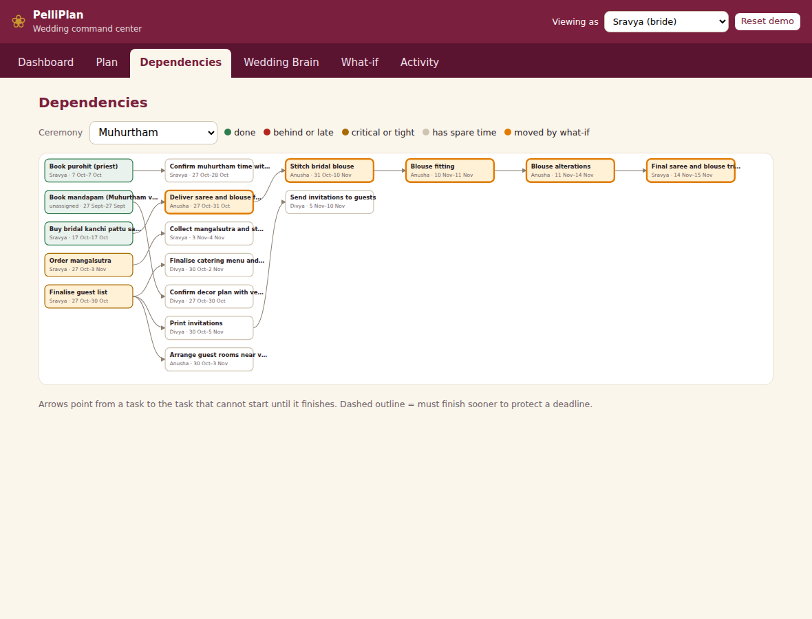

# PelliPlan

A wedding operating system for a Telugu wedding. It treats the wedding as a **dependency graph**, not a flat
checklist, so it can tell you what a delayed delivery will break, and it keeps the whole family in one shared
workspace with the right people seeing the right things.



## What it does

**1. Dependency engine** (`app/engine.py`). Tasks depend on other tasks. The engine computes earliest and latest
dates, slack, and the critical path. Ask "what if the fabric delivery slips 5 days?" and it shows every task that
moves, every deadline that is missed, the chain that explains why, and a recovery plan with its cost. It is plain,
deterministic code: no AI, no clock, no database. Same input, same answer.

**2. Wedding Brain** (`app/brain.py`). Upload a vendor quote or planning notes; it extracts tasks, dates, amounts
and dependencies, each with the *exact words it came from*. Ask "What am I forgetting for my muhurtham?" and it
checks your real plan against a ceremony checklist and explains why each gap matters. The AI reads and explains.
It never changes the plan: code validates every extraction, and a person confirms every item.

**3. Shared command center** (`app/auth.py`). The bride sees everything. Bridesmaids see the team plan and update
the tasks assigned to them, but never see money or private notes. Family members see only what is shared with
them and approve specific items. All of this is enforced on the server, never in the browser.

## Try it (about 3 minutes)

```bash
python3 -m venv .venv && source .venv/bin/activate
python -m pip install -r requirements.txt
cp .env.example .env                 # optional: add ANTHROPIC_API_KEY in .env for AI mode; it works without one
python -m pytest -q                  # 60+ tests, no key needed, no cost
python -m uvicorn app.main:app       # then open http://localhost:8000
```

1. Click **Start the demo wedding**. The dashboard shows the Muhurtham as *Tight*.
2. **What-if**: delay "Deliver saree and blouse fabric" by 5 days. Muhurtham becomes *At risk*, two deadlines are
   missed, and the cheapest fix is a paid speed-up of the stitching. Click **Show on the dependency graph**.
3. **Approve** the plan. The delay is recorded, the schedule recalculates, and the ceremony is back to *Tight*.
4. **Wedding Brain**: upload `samples/planning_notes.txt`. Two items are flagged as duplicates of existing tasks.
   Confirm a few. Then ask "What am I forgetting for my muhurtham?"
5. Switch **Viewing as** to Anusha (bridesmaid), then Venkat Garu (family), and watch what disappears.

Without an API key the Brain uses rule-based extraction and templated explanations, and labels itself that way.
Images and scanned PDFs need the AI key.

## How it fits together

```
documents / notes --> extraction (AI or rules) --> validation in code --> human confirms --> tasks + dependencies
                                                                                                   |
                          ceremonies, vendors, amounts                                             v
                                                                                       dependency engine (pure code)
   who can see what  <-- server-side permissions                                         |        |         |
                                                                                    schedule   what-if   recovery plan
   activity history  <-- every change is logged                                               |
                                                                  AI only EXPLAINS results; every number it writes is checked
```

| Layer | Choice | Why |
| --- | --- | --- |
| Engine | pure Python | testable with hand-calculated dates |
| API | FastAPI + Pydantic | typed inputs, clear errors |
| Storage | SQLite (standard library), plain SQL | one file, no setup, easy to move to Postgres |
| UI | plain HTML, CSS and JS | no build step; user text is never inserted as HTML |
| AI | Claude, behind one wrapper | optional; validated; the app works without it |

## What is checked before AI output is trusted

- Extraction: the quoted evidence must really appear in the document; amounts must appear in the document;
  dates, ceremonies and names must make sense; duplicates and circular dependencies are caught. Items with
  warnings need an explicit "I checked" before they can be added.
- "What am I forgetting": the code finds the gaps. The model may only explain items the code found, and may not
  introduce any number that is not in the facts. Otherwise the answer falls back to plain rules.
- Unreadable or invalid AI output is discarded, never guessed at.

## Tests

`python -m pytest -q` runs 60+ tests: hand-checked scheduling maths, cycle detection, permission rules (including
that money never appears in a non-bride's responses), upload security, AI failure modes, and regressions for the
bugs listed in `docs/DESIGN.md`. They never read `.env` or call an API. `scripts/ui_smoke.py` drives the real UI in
a browser (optional; needs Playwright).

## Honest status

- This is a working vertical slice, not a finished product. It was built to demonstrate the architecture.
- The AI paths were developed with scripted model replies and the rule-based fallback. Run them with your own
  key and read the results before trusting them.
- Not built: reminders and a background job queue, real sign-in (the demo uses per-person tokens), email or
  WhatsApp notifications, vendor and budget views, offline mode.
- Durations are calendar days, not working days. Dependencies are finish-to-start only.
- The ceremony checklists in `app/templates.json` are starting points. Families differ; check them with your
  elders and purohit.
- The people in the demo are invented.
- Next.js and PostgreSQL were left out on purpose to keep it runnable with one command. The storage and API
  layers are separated so they can be swapped.

## How this was built

I built this with help from an AI assistant (Claude) for much of the code, and I ran, tested and reviewed it
myself. The design decisions and trade-offs in `docs/DESIGN.md` are ones I can explain and defend.
